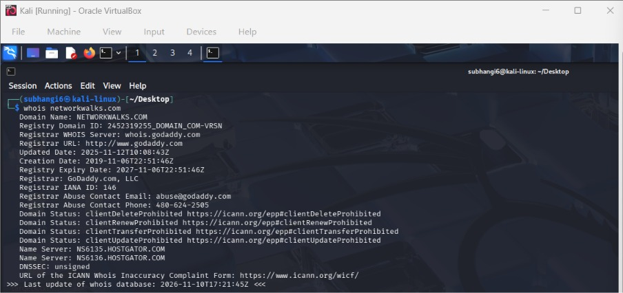
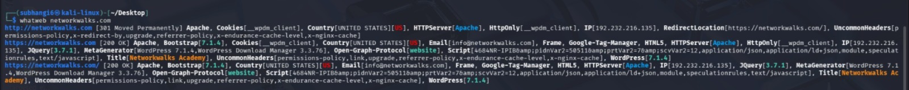
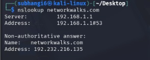
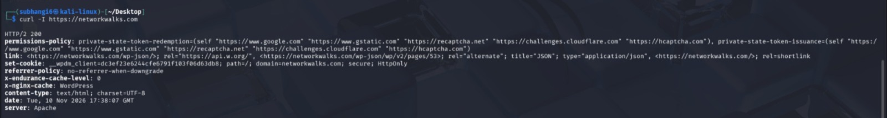
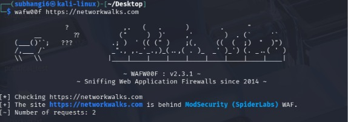
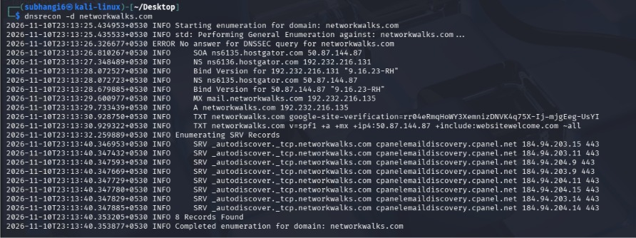

# W2-PM1 – Footprinting & Reconnaissance Using Kali Linux

## Internship Programme
**Networkwalks Cybersecurity Internship – Batch B084**

## Objective
To understand footprinting and reconnaissance techniques using Kali Linux tools and identify publicly available information associated with a domain.

## Tools Used
- WHOIS
- WhatWeb
- Nslookup
- Curl
- Wafw00f
- DNSRecon

## Practical Activities

| No. | Tool | Activity |
|---|---|---|
| 1 | WHOIS | Domain registration enumeration |
| 2 | WhatWeb | Web technology fingerprinting |
| 3 | Nslookup | DNS resolution |
| 4 | Curl | HTTP header analysis |
| 5 | Wafw00f | WAF detection |
| 6 | DNSRecon | DNS enumeration |

## Evidence and Screenshots

### 1. WHOIS Enumeration

### 2. WhatWeb Fingerprinting

### 3. DNS Resolution Using Nslookup

### 4. HTTP Header Analysis Using Curl

### 5. Web Application Firewall Detection

### 6. DNS Enumeration Using DNSRecon

## Disclaimer
This documentation is intended for authorized educational and internship activities. Target-specific findings and screenshots must not be publicly disclosed without appropriate authorization.
